# PSX Final Fantasy VI 한글 패치 · V0.76

PlayStation 일본판 **파이널 판타지 VI / Final Fantasy VI (SLPM-86198)**의 한글 패치입니다. 대사와 메뉴, 전투 메시지, PSX 저장 화면, 부록을 번역하고 한글 이름 작성기, 별도 동영상 자막, 부스트 설정, 문장 관리기를 구현했습니다.

**공개 V0.76은 텐트·설정 커서·금액 글꼴·대사 검수 수정을 반영한 내부 v086 기반입니다.** 원본 게임 이미지와 BIOS는 포함하지 않으며, 사용자가 보유한 지원 원본 BIN에 패치를 적용합니다. 현재는 전체 플레이 검증이 끝나지 않은 **공개 테스트 릴리스**입니다.

[**V0.76 다운로드**](https://github.com/OldManCraveGuitars-bit/PSX-Final-Fantasy-6-Kr/releases/tag/v0.76) · [설치 방법](docs/INSTALL.md) · [구현 내용](docs/FEATURES.md) · [전체 스크린샷](docs/SCREENSHOTS.md) · [확인된 제한](docs/KNOWN_ISSUES.md)

## V0.76의 수정 사항

- **설정 커서 복구:** 설정 두 페이지와 부스트에서 돌아왔을 때 손 커서가 정상적으로 표시됩니다.
- **텐트 사용 후 멈춤 수정:** 월드맵 복귀 시 필요한 데이터의 끝부분까지 다시 읽도록 수정했습니다. 월드맵과 나르셰 탄광 세이브 포인트에서 텐트 소모·HP/MP 회복·화면 복귀·이동을 확인했습니다.
- **보물상자 금액 글꼴 복구:** 동적으로 표시하는 숫자의 원본 픽셀을 보존했습니다. 500·1,000·1,500길 표시를 확인했습니다.
- **대사 검수:** 본편 3,084개·PSX 도움말 16개·전투 문장 512개·전투 기술/대사 296개, 총 **3,908개 기록**을 읽어 문맥·조사·용어·줄 흐름을 점검했습니다. 문구·줄바꿈 변경은 1,237개, 검사 폭만 변경한 기록은 248개입니다. 빈 기록과 중복 문구를 포함한 항목 수입니다.
- **콜츠산·필살기 설명:** ‘게’ 한 글자가 따로 남던 줄과 필살기 안내의 오른쪽 잘림을 수정했습니다. 전투 대사는 204px 검사 폭으로 오른쪽 여유를 두고, 몬스터 상단 메시지는 216px를 유지합니다.
- **문장 관리기 1.14:** 줄 끝에서 공백이 사라져 단어가 붙던 오류를 편집기와 게임 삽입기 양쪽에서 수정했습니다. 원래 큰 글씨 크기, 갈무리7 작은 글씨, 반각 공백을 유지합니다.

이전 적 공격명·전투창·록 직업 수정과 부록 해금 조건은 유지합니다. 문장 검수와 제보 구간 실행 확인을 진행한 버전이며, 게임 전체를 끝까지 플레이한 검증은 아닙니다. [이번 검증 자료](docs/verification/v086-release-verification.json)를 참고하세요.

## 다운로드 파일

| 파일 | 용도 |
| --- | --- |
| `FF6-KR-Patcher-V0.76.zip` | 일반 사용자용. Windows x64 한글 패처 EXE와 사용법·라이선스. Python 설치 불필요 |
| `FF6-KR-V0.76-xdelta.zip` | 수동 적용용 xdelta 패치, 매니페스트, CUE 견본, 사용법 |
| `FF6-Korean-Text-Manager-V1.14-V0.76.zip` | 문장 관리기 EXE와 7,720개 편집 항목, 번역 원본·배치 설정 |
| `SHA256SUMS.txt` | 배포 ZIP 파일의 SHA-256 |

GitHub의 자동 생성 `Source code` ZIP은 소스 열람용입니다. 게임에 바로 적용하려면 **패처 ZIP**을 받으세요.

## 빠른 적용

1. `FF6-KR-Patcher-V0.76.zip`을 풀고 `FF6-KR-Patcher-V0.76.exe`를 실행합니다.
2. 패치하지 않은 **일본판 원본 BIN**을 선택합니다.
3. 완성 파일을 저장할 폴더를 선택하고 **한글 패치 적용**을 누릅니다.
4. 새로 생성된 `FF6-KR-V0.76/Final Fantasy VI (Korean V0.76).cue`를 에뮬레이터에서 실행합니다.

패처는 원본 크기·SHA-256, 내장 패치·변환 도구, 완성된 BIN의 SHA-256을 검사합니다. 원본은 수정하지 않으며 기존 결과 폴더도 덮어쓰지 않습니다.

| 구분 | 값 |
| --- | --- |
| 지원 기종·판본 | PlayStation 일본판, SLPM-86198 |
| 원본 형식 | 단일 트랙 BIN/CUE, MODE2/2352 |
| 원본 BIN 크기 | 325,133,424 bytes |
| 원본 SHA-256 | `a607011d9c9442797ae155228e86e9dae6e503aaeb7dc9603ac552ffd8d036df` |
| 패치 결과 SHA-256 | `08dafb67d22f8cb1d69dd0437ad18101844eeb2a32e4ea1d66ffbf278f73c91c` |

이전 개발본의 에뮬레이터 **상태 저장**에는 예전 코드가 남을 수 있습니다. 새 CUE로 재시작한 다음 **게임 내 메모리 카드 저장**을 불러오세요. 파일명에 따라 메모리 카드를 따로 관리하는 에뮬레이터에서는 카드 연결을 확인하고 기존 카드를 먼저 백업하세요.

## 주요 화면

이번 V0.76 수정 화면은 내부 v086에서 촬영했습니다. 직업·적 공격명 등 기존 기능은 해당 기능을 검수한 개발본의 화면도 함께 제공합니다. 장면별 촬영 버전과 검수 조건은 [스크린샷 설명](docs/SCREENSHOTS.md)에 기재했습니다.

| **설정 커서 복구** | **월드맵 텐트 사용 후 복귀** |
| --- | --- |
| 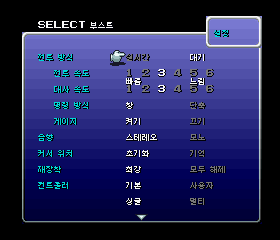 | 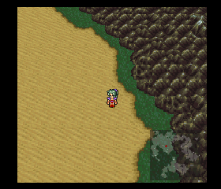 |
| **금액 글꼴 복구** | **필살기 안내 줄바꿈** |
| 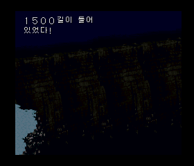 | 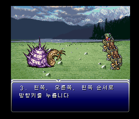 |

| 가운데 정렬 프롤로그 | 한글 메뉴와 록의 직업 |
| --- | --- |
| 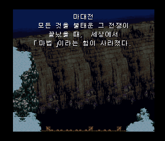 | 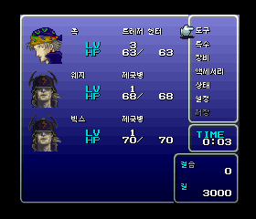 |
| **별도 오프닝 자막** | **게임 안에서 한글 이름 조합** |
| 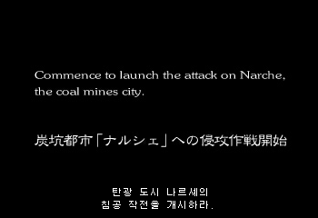 | 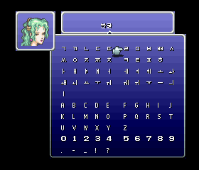 |
| **부스트 기본 OFF** | **적 공격명 전체 표시** |
| 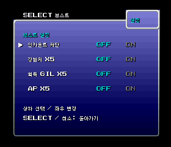 | 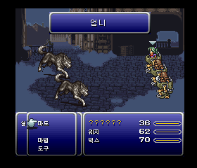 |
| **청마법 도감** | **용의 목 콜로세움** |
| 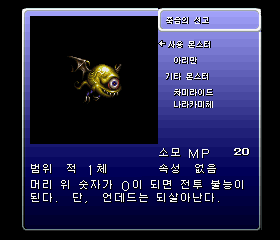 | 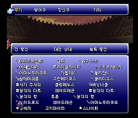 |

## 구현 범위

| 영역 | 현재 구현 |
| --- | --- |
| 본편 대사 | 본편 3,084개 항목과 PSX 보조 대사 16개. 문맥·조사·종결 부호 검수 반영 |
| 메뉴·카탈로그 | 메뉴 글씨, 도구·마법·몬스터·기술 이름, 설명문, 직업, 지역명 |
| 전투 | 큰 글씨 렌더러, 동적 이름·수치 처리, 전투 대사·적 메시지·시스템 문구 |
| PSX 전용 UI | 저장·불러오기·임시 저장, 카드 안내, 저장 목록의 이름·직업 미리보기 |
| 부록 | 기록 할아버지, 청마법 도감, 용의 목 콜로세움, 메뉴·설명, 갤러리 설명 |
| 글꼴·간격 | 큰 글씨는 원래 12px 경로 유지. 작은 글씨는 갈무리7. 공백은 반각 6px/4px |
| 이름 작성기 | 패드로 자음·모음 조합, 최대 6글자, 조합 단계별 지우기, 한글·영문·공백 혼용 |
| 동영상 | 원본 영상 스트림 보존. 별도 12×12 자막 렌더러로 오프닝 24개·엔딩 5개 큐 표시 |
| 부스트 | 인카운트 차단, 경험치×5, 획득 GIL×5, AP×5. 기본 전부 OFF |
| 메뉴 로딩 | 일부 필드·글꼴 자원의 RAM/VRAM 보존 및 복원으로 반복 메뉴 복귀 시간 단축 |
| 편집 도구 | 문장 관리기 v1.14. 7,720개 항목, 픽셀 폭·줄 수·줄 간격·제어 코드 검사, 자동 백업 |

위 수치는 서로 다른 출력 경로를 포함하므로 단순 합산한 고유 문장 수가 아닙니다. 등록·검사된 항목 수와 게임 전체 검증률도 구분해야 합니다.

### 부스트 사용법

필드에서 메뉴를 열고 **설정 → SELECT**로 부스트 화면에 들어갑니다. 위/아래로 항목 선택, 왼쪽 OFF·오른쪽 ON, 결정 버튼으로 전환, 취소 또는 SELECT로 돌아갑니다. 설정은 즉시 반영되고 게임 내 저장에도 유지됩니다.

`인카운트 차단 OFF`가 원래의 무작위 전투 상태이며, ON이면 무작위 전투를 막습니다. 이야기 진행에 필요한 이벤트 전투는 유지합니다. 부록의 도감·영상·갤러리 **해금 조건은 원판 그대로**입니다.

### 메뉴 속도

초반 나르셰 필드에서 Mednafen 1.32.1의 정상 CD 타이밍으로 비교한 결과입니다. 비교 대상은 내부 v080 → 캐시를 도입한 v081이며, V0.76/v086에도 해당 경로가 유지되어 있습니다.

| 동작 | 이전 | 캐시 적용 | 차이 |
| --- | ---: | ---: | ---: |
| 반복 메뉴 닫기 | 5.20초 | 3.80초 | 약 26.9% 단축 |
| 반복 메뉴 열기 | 3.13초 | 3.33초 | 0.20초 증가 |
| 반복 왕복 | 8.33초 | 7.13초 | 약 14.4% 단축 |

모든 메뉴가 2초 안에 열리는 패치는 아닙니다. 이름 입력·저장 화면·캐시 용량을 넘는 장면 등에서는 원래 로딩 경로를 사용합니다. [측정 조건과 결과](docs/TESTING.md)를 참고하세요.

## 이전 버전에서 이어지는 수정

V0.75-r1/v085에서 복원한 직업과 앞선 전투·메뉴 수정도 포함합니다.

- 적 전용 공격명의 참조 값이 종료 바이트로 잘못 해석되어 **엄니 → 니**처럼 잘리던 문제 수정. 적 전용 이름 384개 경로를 검사했습니다.
- **1만 볼트·100만 볼트** 등 큰 글씨의 숫자 글리프가 주입 코드와 겹치던 문제 수정.
- 전투 대사와 하단 상태창을 구성하는 원래 창 처리 루프 복원. 긴 대사는 원래의 하단 전체 폭 창, 짧은 공격명·알림은 상단 창을 사용합니다.
- 록의 **직업은 모험가**, 대화 속 호칭은 **트레저 헌터**로 구분했습니다. 메뉴·저장 미리보기·부록의 직업을 모험가로 복원하고 대사와 조사는 유지했습니다.
- 티나의 이름이 정해지기 전에는 원래의 **??????** 표시를 유지합니다.
- 마법 메뉴의 글꼴/화면 자원 충돌, PSX 저장 문구 순서, 임시 저장창 테두리, 직업 표기 수정들을 포함했습니다.

[변경 내역](CHANGELOG.md) · [기술 설명](docs/TECHNICAL.md) · [검증 자료](docs/TESTING.md)

## 아직 남은 작업

- **오페라 영상의 노래 가사 자막은 미완료**입니다. 확정되지 않은 가사와 타이밍은 넣지 않았습니다. 오프닝·엔딩 화면 문구 자막과 구별해 주세요.
- 일부 정적 일본어 이미지/크레딧, 전투 마법 상세창의 `しょうひ MP` 같은 기존 텍스처 문구가 남아 있습니다.
- 갤러리의 판독하기 어려운 작은 손글씨 메모 1곳은 원문을 보존했습니다.
- 전체 엔딩까지 모든 이벤트·전투·장비·이름 조합을 실기나 모든 에뮬레이터에서 확인한 버전은 아닙니다.
- 문장 관리기의 칸 검사와 코드 검증은 실제 게임의 모든 그래픽/VRAM 문제를 보증하지 않습니다. 추정 경계와 가변 문자열 관련 주의 항목이 남아 있습니다.

자세한 조건과 제보 방법은 [알려진 제한](docs/KNOWN_ISSUES.md)을 확인하세요.

## 문서와 소스

- [설치 및 패처 사용법](docs/INSTALL.md)
- [세부 기능·조작](docs/FEATURES.md)
- [문장 관리기 사용법](docs/TEXT_MANAGER.md)
- [26개 게임 화면과 촬영 정보](docs/SCREENSHOTS.md)
- [런타임 구현·최근 오류 원인](docs/TECHNICAL.md)
- [검사 결과·검증 범위](docs/TESTING.md)
- [개발용 소스와 빌드 제약](docs/DEVELOPMENT.md)

`native/`는 MIPS 훅·게임 내 렌더러, `tools/`는 추출·인코딩·삽입·검사와 문장 관리기, `translations/`는 편집 원본입니다. `patcher/`는 이번 배포용 패처 소스입니다. 원본 게임 및 로컬 추출 중간 파일은 포함하지 않으므로, 전체 게임 이미지의 클린 빌드가 바로 가능한 저장소는 아닙니다.

## 권리 및 외부 구성 요소

게임·캐릭터·영상·원본 그래픽의 권리는 각 권리자에게 있습니다. 스크린샷은 패치 동작 설명을 위한 실제 실행 화면입니다. 갈무리 글꼴은 SIL OFL 1.1, xdelta3 3.2.1은 Apache 2.0 등 각 구성 요소의 라이선스를 따릅니다. [고지](NOTICE.md)와 [`licenses/`](licenses/)를 확인하세요.
