# 실제 실행 스크린샷

총 38장입니다. 원본 캡처의 비율과 픽셀을 유지했습니다. 공개 V0.77의 내부 기준은 v087이며, 이전 개발 단계에서 같은 기능을 검수한 사진도 포함합니다. 각 사진에 내부 촬영 번호를 적었습니다.

부록 해금 상태와 파티 구성은 검수용 상태에 따릅니다. 새 게임에서 모두 열려 있거나 사진과 같은 파티로 시작한다는 뜻은 아닙니다.

## 01. 프롤로그 · 원래 큰 글씨 크기와 가운데 정렬

촬영 원본: `kr-v053-prologue-original-size.png`.

해당 기능을 검수하던 개발본의 실제 실행 화면입니다.

## 02. 오프닝 · 원본 영상 위 별도 한국어 자막

촬영 원본: `kr-v061-opening-attack-order.png`.

영상에 찍힌 원문을 지우거나 재인코딩하지 않고 아래에 별도 한국어 자막을 그립니다.

## 03. 엔딩 영상 · 화면 문구 자막

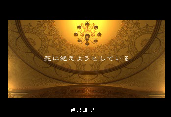

촬영 원본: `v076-ending-caption-155.png`.

화면 문구 자막의 예입니다. 오페라 노래 가사 자막 완료를 뜻하지 않습니다.

## 04. 록 직업 · 모험가

촬영 원본: `v085-locke-menu-job.png`.

록을 배치한 검수 상태에서 필드로 나갔다가 v085 디스크의 메뉴를 새로 읽어 모험가를 확인했습니다. 초반 파티를 변경하는 기능이 아닙니다.

## 05. 적 공격명 · 엄니 전체 표시

촬영 원본: `v084-native-enemy-special-25.png`.

원래 늑대 AI가 엄니를 쓰는 레벨 조건(7 초과)을 맞추기 위해 검수 RAM에서 파티 레벨을 8로 설정했습니다. 공격/AI 코드나 배포 시작 레벨은 변경하지 않았습니다.

## 06. 껍질 반격 · 1만 볼트 숫자 표시

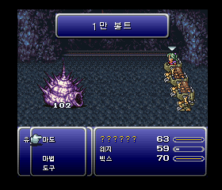

촬영 원본: `v083-volts-counter-name.png`.

껍질을 공격했을 때 원래 반격 경로에서 표시된 1만 볼트입니다.

## 07. 전투 대사 · 원래의 하단 전체 폭 창

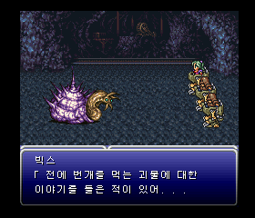

촬영 원본: `kr-v083-whelk-battle_dialogue-8.png`.

긴 캐릭터 대사는 원판의 하단 전체 폭 창을 사용합니다. 짧은 공격명은 상단에 표시됩니다.

## 08. 부스트 · 네 항목 기본 OFF

촬영 원본: `kr-v075-boost-final-all-off.png`.

해당 기능을 검수하던 개발본의 실제 실행 화면입니다.

## 09. 부스트 · 실시간 설정

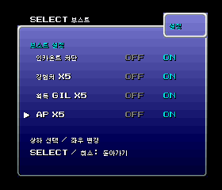

촬영 원본: `kr-v075-boost-final-all-on.png`.

해당 기능을 검수하던 개발본의 실제 실행 화면입니다.

## 10. 설정 · 마법 정렬

촬영 원본: `kr-v075-boost-magic-order-final.png`.

해당 기능을 검수하던 개발본의 실제 실행 화면입니다.

## 11. 이름 작성기 · 자음과 모음으로 한글 조합

촬영 원본: `v081-name-composed.png`.

해당 기능을 검수하던 개발본의 실제 실행 화면입니다.

## 12. 메모리 카드 저장 확인 문구

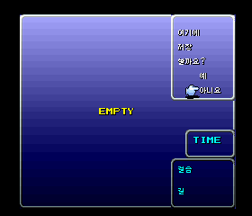

촬영 원본: `v081-save-regression-question.png`.

해당 기능을 검수하던 개발본의 실제 실행 화면입니다.

## 13. 임시 저장 · 테두리 표시

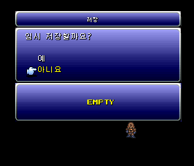

촬영 원본: `v081-save-regression-temp-after-wait.png`.

해당 기능을 검수하던 개발본의 실제 실행 화면입니다.

## 14. 부록 · 추가 메뉴

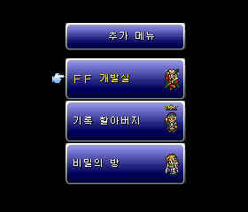

촬영 원본: `kr-v071-cold-bonus-root.png`.

해당 기능을 검수하던 개발본의 실제 실행 화면입니다.

## 15. 부록 · 청마법 도감

촬영 원본: `v076-blue-magic-list.png`.

해당 기능을 검수하던 개발본의 실제 실행 화면입니다.

## 16. 부록 · 용의 목 콜로세움

촬영 원본: `v076-colosseum-list.png`.

해당 기능을 검수하던 개발본의 실제 실행 화면입니다.

## 17. 부록 · 최고/최저 기록 배치

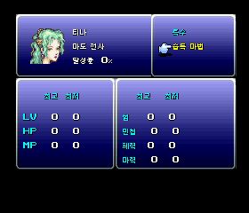

촬영 원본: `v076-record-details-final.png`.

최고/최저 위치 확인용 검수 저장의 수치입니다. 배포본의 기록 수치를 0으로 고정하는 기능이 아닙니다.

## 18. 갤러리 · 그림을 보존한 설명 번역

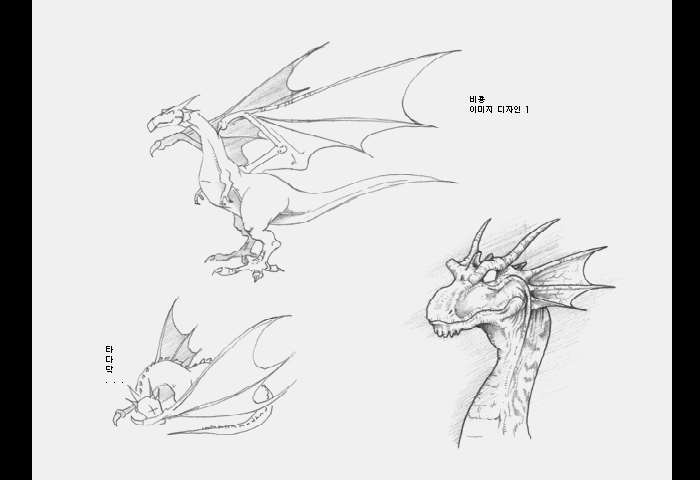

촬영 원본: `kr-v071-cold-gallery5-design.png`.

해당 기능을 검수하던 개발본의 실제 실행 화면입니다.

## 19. V0.76 · 설정 손 커서

촬영 원본: `v086-final-config-cursor.png`. 내부 v086.

실제 설정 진입. 메뉴 코드가 새 디스크에서 읽힌 것을 대조했습니다.

## 20. V0.76 · 설정 두 번째 페이지

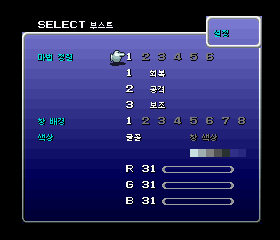

촬영 원본: `v086-final-config-second-page.png`. 내부 v086.

패드로 두 번째 페이지까지 이동해 커서와 마법 정렬을 확인했습니다.

## 21. V0.76 · 월드맵 텐트 복귀

촬영 원본: `v086-final-world-tent-return.png`. 내부 v086.

테스트 위치와 텐트 수량을 지정한 뒤 원래 메뉴로 사용했습니다. 텐트 소모·HP/MP 회복·복귀·이동을 확인했습니다.

## 22. V0.76 · 탄광 세이브 포인트 텐트 복귀

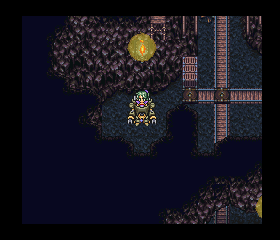

촬영 원본: `v086-final-dungeon-tent-return.png`. 내부 v086.

나르셰 탄광의 실제 세이브 포인트를 밟았습니다. 사용 허용 플래그나 로더를 바꾸지 않고 원래 메뉴로 사용했습니다.

## 23. V0.76 · 1,500길 숫자 복구

촬영 원본: `v086-native-dialogue-2951-1500.png`. 내부 v086.

네이티브 필드 출력기에 2,951번 문장과 금액 1,500을 테스트 입력했습니다. 원본 숫자 픽셀을 대조했고 500·1,000도 확인했습니다.

## 24. V0.76 · 콜츠산 대사 줄 흐름

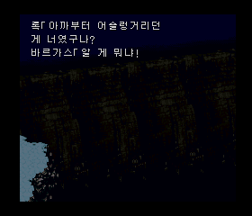

촬영 원본: `v086-native-dialogue-250.png`. 내부 v086.

새 디스크의 필드 출력기에서 250번 문장을 선택해 확인했습니다. 배경은 테스트 장면이며 콜츠산을 실제로 진행한 캡처는 아닙니다.

## 25. V0.76 · 필살기 설명 잘림 수정

촬영 원본: `v086-final-blitz-tutorial-214.png`. 내부 v086.

새 디스크의 전투 출력기에 214번 설명을 선택했습니다. 실제 큰 글씨·대기 루틴을 사용했으며 바르가스 전투 전체를 진행한 사진은 아닙니다.

## 26. V0.76 · 전투 대사 후 정상 복귀

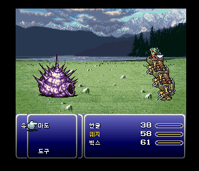

촬영 원본: `kr-v086-whelk-dialogue-return.png`. 내부 v086.

테스트 필드에서 유미르 전투를 요청한 뒤 원래 대사 6–11, 몬스터 대사 5와 전투 복귀를 확인했습니다. 배경은 테스트 입력값입니다.

## V0.77 · 필살검 출력 경로

아래 12장은 내부 v087의 실제 네이티브 화면입니다. 격리된 Mednafen에서 파티/명령/습득 기술/능력치/전투 편성을 설정한 기능 검사입니다. 제국군 진지나 도마성 전체 이벤트의 플레이를 뜻하지 않습니다. 전투 8단계는 패드로 게이지를 기다린 후 결정했습니다. 코드·문구·글꼴을 대체 주입하지 않았고, 최종 디스크의 전투 코드·문자표·사용 글리프가 검사 상태의 메모리와 같은 것을 확인했습니다. 메뉴는 최종 디스크에서 다시 열어 코드 일치를 확인했습니다.

이름 변경은 첫 글자를 실제 선택 문자로 바꿨습니다. `필살검 아` → `아살검 아`는 표시 연결을 확인하기 위한 시험 이름입니다. 게임 내에서 카이엔의 이름을 바꾼 것이 아닙니다.

### 27. 필살검 8종 목록

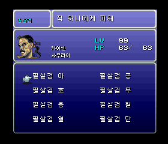

촬영 원본: `v087-swdtech-list.png`. 내부 v087.

### 28. 이름 변경 문자 선택 화면

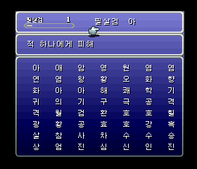

촬영 원본: `v087-swdtech-rename.png`. 내부 v087.

### 29. 선택한 한글의 이름 미리보기

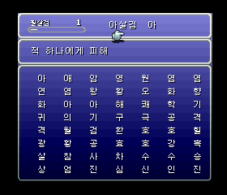

촬영 원본: `v087-swdtech-rename-input.png`. 내부 v087.

### 30. 바꾼 이름의 전투 표시

촬영 원본: `v087-bushido-custom-name.png`. 내부 v087.

### 31. 필살검 아

촬영 원본: `v087-bushido-native-1.png`. 내부 v087.

### 32. 필살검 공

촬영 원본: `v087-bushido-native-2.png`. 내부 v087.

### 33. 필살검 호

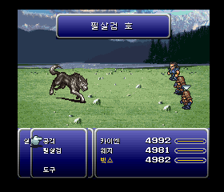

촬영 원본: `v087-bushido-native-3.png`. 내부 v087.

### 34. 필살검 무

촬영 원본: `v087-bushido-native-4.png`. 내부 v087.

### 35. 필살검 용

촬영 원본: `v087-bushido-native-5.png`. 내부 v087.

### 36. 필살검 월

촬영 원본: `v087-bushido-native-6.png`. 내부 v087.

### 37. 필살검 열

촬영 원본: `v087-bushido-native-7.png`. 내부 v087.

### 38. 필살검 단

촬영 원본: `v087-bushido-native-8.png`. 내부 v087.
