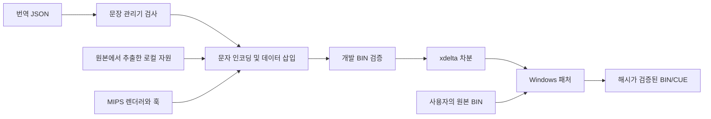

# 구현 구조와 오류 수정

## 텍스트 파이프라인

`translations/`가 편집 원본입니다. 문장 관리기는 원문/분류 메타데이터와 픽셀 폭 정보를 읽고 편집 내용을 저장합니다. 빌드 도구는 이 데이터를 게임의 압축·포인터·문자 코드 체계에 맞게 변환하고, MIPS 런타임과 함께 각 실행 영역에 삽입합니다.

## 런타임별 역할

| 소스 | 역할 |
| --- | --- |
| `native/dialogue_runtime.c`, `dialogue_hooks.S` | 필드 대사의 한글 출력 경로 |
| `native/small_runtime.c`, `small_hooks.S` | 갈무리7 작은 글씨, 문자열 참조 및 반각 간격 |
| `native/menu_big_text.c` | 큰 메뉴 글씨와 이름·설명 참조 |
| `native/battle_runtime.c`, `battle_big_text.c` | 전투의 작은/큰 글씨, 동적 이름, 수치, 창 표시 경로 |
| `native/hangul_name.c`, `name_editor.c` | 초성·중성·종성 조합과 게임 안 이름 UI |
| `native/psx_name_preview.c` | PSX 저장 파일마다 이름과 미리보기 글꼴 준비 |
| `native/movie_subtitles.c`, `movie_subtitles.S` | 원본 프레임 번호에 맞춘 별도 자막 |
| `native/boost_settings.c`, `boost_gameplay.S` | 설정 페이지, 플래그 저장, 인카운트·보상 분기 |
| `native/menu_cache_prepare.*`, `menu_field_cache.*` | 메뉴 왕복 시 제한된 필드 자원 보존/복원 |
| `tools/text_manager*.py` | 편집 원본 관리와 픽셀 단위 배치 검사 |
| `patcher/patcher.py` | 원본·차분·결과 해시 검사와 안전한 새 파일 생성 |

## 적 공격명이 마지막 글자만 나오는 문제

내부 v083에서는 적 전용 공격명의 한글 참조를 원래의 8바이트 이름 복사 경로에 통과시켰습니다. 한글 참조는 4바이트 구조이고, 참조 ID에 따라 중간 피연산자에 `FF`가 들어갑니다. 원래 복사기는 `FF`를 문자열 끝으로 판단하므로 참조 254와 509가 잘렸습니다. 이 때문에 **엄니**와 **구타**가 잘못 표시되었습니다.

v084의 `kr_big_monster_attack_source`는 완전한 참조를 원래 출력 목적지 `0x800237d5`에 직접 기록합니다. 훅은 종료값을 찾는 복사 반복문을 건너뛰고 원래 종결·표시 경로 `0x801408f8`로 이어지며 레지스터와 목적지 위치를 복원합니다.

검증은 문자열 표 검색에서 끝내지 않고 실제 MIPS 생성기와 원래 소비 경로를 함께 실행했습니다. **384개** 적 전용 이름의 완전한 글리프 시퀀스와 버퍼 경계를 확인했습니다. 초반 늑대 AI는 레벨 7 초과에서 엄니를 선택하므로 별도 검수 RAM에서 파티 레벨을 8로 설정해 실제 AI 공격을 촬영했습니다. 배포 이미지의 시작 레벨이나 공격 AI를 바꾼 것은 아닙니다.

## 숫자 공격명 글리프 충돌

원래 숫자 0–9의 글리프 위치 1075–1084가 주입된 런타임/LUT 영역과 겹쳤습니다. v083부터 원본 22바이트 숫자 비트맵을 안전한 위치 901–910으로 복사하고 공통 글리프 경로에서 숫자를 재지정합니다.

255개 공격명 경로와 숫자 10개의 원본 픽셀을 비교했습니다. 글자 크기를 줄여 해결한 것이 아니며, 원래 12×11 숫자 픽셀과 6px 공백을 유지합니다.

## 전투 창과 하단 회색 띠

패치 훅이 덮은 `0x801516e8`의 LUI 명령은 원래 반복문의 되돌아오는 지점으로도 사용되었습니다. 이를 놓치면 전투 대사와 하단 상태창을 포함한 여러 창 슬롯이 잘못 처리됩니다.

v082부터 지연 슬롯의 원래 명령 `0x3c038003`을 복원했습니다. 8개 창 슬롯의 활성화 조합 256개를 원래 동작과 비교했습니다. 긴 캐릭터 대사는 원래 하단 전체 폭 창을 사용하고, 짧은 공격명·AI 알림은 상단 한 줄 창을 사용합니다. 원판의 구분을 보존합니다.

## 록의 직업과 호칭

v084에서 대사 ID **42, 48, 134, 1901, 2616, 2936**의 호칭을 **트레저 헌터**로 정리했으나 메뉴·저장 미리보기·부록의 직업까지 같은 말로 바뀌었습니다. v085/V0.75-r1에서 직업 표기는 **모험가**로 복원했습니다. 대사와 인물 소개의 트레저 헌터, 그리고 관련 조사는 그대로 유지합니다.

문장 관리기의 직업 1번과 부록 작은 글씨 710번만 모험가로 수정했습니다. 메뉴 이름 풀과 PSX 저장 미리보기의 글꼴 뱅크를 함께 다시 만들고, 부록 직업 참조를 복원했습니다. 이 네 자원은 직업 변경 전 v083과 바이트 단위로 같음을 확인했습니다.

필드 대사와 전투 페이로드는 v084와 완전히 같습니다. 압축 메뉴 미러의 앞 두 구간만 복원하고 나머지 필드 스크립트·캐시 데이터는 그대로 유지했습니다. 따라서 최근 적 공격명·숫자 글리프·전투창 수정과 메뉴 캐시 경로를 되돌리지 않습니다.

## 메뉴 캐시

PSX의 제한된 메모리 안에서 재사용할 수 있는 필드 데이터와 VRAM 영역만 저장합니다. 진입 시 캡처와 복귀 시 복원을 분리하고, 전체 한글 이름 글꼴 뱅크는 이름 작성기 진입 시 적재합니다. 캐시 용량·장면 상태에 따라 원래 재로딩 경로로 돌아갑니다.

v084에서 록 호칭과 적 공격명을 수정하면서 캐시 관련 실행 경로와 상주 코드가 이전 검증본과 같음을 확인했습니다. 측정 결과는 [TESTING.md](TESTING.md)에 수치와 제한을 함께 공개합니다.

## 패처

원본과 결과의 바이트 크기 및 SHA-256을 매니페스트에 고정했습니다. xdelta3 3.2.1의 VCDIFF 차분은 원본 게임 전체를 담는 배포 형식이 아닙니다. 변환은 소유한 임시 디렉터리에서 수행하고 해시 검증이 성공하면 새 결과 폴더로 이동합니다.

내부 변환 프로세스는 별도 콘솔 창을 띄우지 않습니다. GUI 작업은 백그라운드 스레드에서 실행하고 메시지를 큐로 전달해 Tk 메인 스레드에서 표시합니다. 실행 중 닫기 요청은 작업이 끝난 뒤 처리하도록 안내하며, 기존 결과 폴더를 덮어쓰는 선택지는 제공하지 않습니다.
